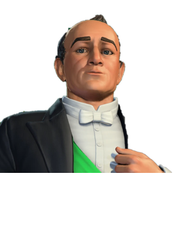
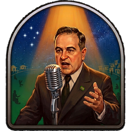
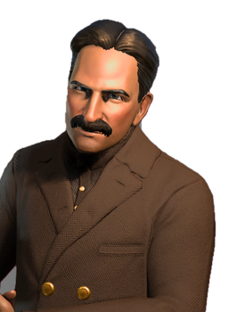
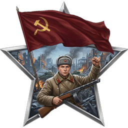

# Project ARA: Reborn

**A collection of independent mods for _ARA: History Untold_**

Project ARA: Reborn brings quality-of-life fixes, a stability fix for end-of-turn freezes, player-built railroads and brand-new playable nations and leaders to ARA: History Untold. 
Every mod ships as its own zip with a one-click installer and uninstaller. Use one, several or all of them together, in any order, make your own History Untold!

## The mods

| Mod | Version | What it does |
|---|---|---|
| [**AraQoL**](mods/AraQoL/README.md) | 2.0 | Higher camera ceiling, map banners that follow their toggle, easier unit clicking, "Upgrade All" buttons |
| [**ARA CPU Fix**](mods/CpuFix/README.md) | 1.0 | Stops the whole-PC freeze during end-of-turn processing |
| [**Railroads**](mods/Railroads/README.md) | 1.9 | Player-built railroads with real track visuals and a new Train Station improvement |
| [**Brazil — Getúlio Vargas**](mods/Brazil/README.md) | 1.0 | New nation: Brazil, led by Getúlio Vargas |
| [**Soviet Union — Joseph Stalin**](mods/SovietUnion/README.md) | 1.0 | New nation: the Soviet Union, led by Joseph Stalin, with two 3D looks |

Downloads: see **[Releases](../../releases)**. One zip per mod.

## New nations

<table>
<tr>
<td align="center" width="50%">
 
<b>Brazil — Getúlio Vargas</b> 
 
<i>Estado Novo</i>: +50% build production towards Industry improvements and +5 to all citizen stats in all cities. 
Unique unit: <b>Pracinhas</b>, rifle infantry of the Brazilian Expeditionary Force.
</td>
<td align="center" width="50%">
 
<b>Soviet Union — Joseph Stalin</b> 
 
<i>Great Patriotic War</i>: +25% strength for land armies in your territory, +50% craft rate in Military improvements, −50% war weariness. 
Unique unit: <b>T-34</b> medium tank. Two 3D looks: <b>1924</b> and <b>1945 marshal</b>.
</td>
</tr>
</table>

Each nation comes with its own leader, AI personality, 3D leader model in the leader screen, portraits, emblems, flag, starting position and full in-game texts.

### Custom audio
Both leaders have **custom introduction narration** (English and Brazilian Portuguese), played when the game's narrator introduces the leader.
The narration was generated with the **Coqui XTTS-v2** text-to-speech model using one of its stock studio voices. No real person's voice was cloned.

### Localization
All mods are presented in English. The nation mods (**Brazil** and **Soviet Union**) also include a full **Brazilian Portuguese (PT-BR)** localization. The language follows the game's language setting automatically.

## Installation

1. Download the zip of the mod from **[Releases](../../releases)**.
2. Close the game and extract the zip anywhere.
3. Double-click **`INSTALL.bat`**. The installer finds the game through Steam. If it can't, run:
   `powershell -ExecutionPolicy Bypass -File install.ps1 -GamePath "C:\path\Ara History Untold"`
4. **Railroads, Brazil and Soviet Union** add game content: enable them when you start a **new game**, because the game stores its rules inside each save.

To remove a mod, run **`UNINSTALL.bat`** from its zip. It restores the original game files.

Good to know:
- Steam's **"Verify integrity of game files"** and game updates restore the original DLLs, which turns the mods off. Run `INSTALL.bat` again afterwards.
- The DLLs check the game build. On a different build, the build-specific parts stay disabled and say so in their log.
- Logs and `.ini` settings are written to the game's `bin` folder.

## How the mods stay independent

Each mod replaces a **different** DLL that the game loads. The original DLL is kept as `<name>_orig.dll` and every export is forwarded to it.

| Mod | Game DLL |
|---|---|
| AraQoL | `swresample-4.dll` |
| ARA CPU Fix | `avutil-58.dll` |
| Railroads | `avformat-60.dll` |
| Brazil / Soviet Union | `swscale-7.dll` (shared leader base) |

Hooks into game functions are chainable (`common/ara_hook.h`), so two mods can hook the same function.

Brazil and the Soviet Union share the [**leader base**](mods/LeaderBase/README.md). It is included in both zips, installed once, and removed when the last nation mod is uninstalled. The base adds the 3D leader parts by **binary patch** on top of the original Steam files, verified by SHA-1. The zips contain only the mods' own data, never game files.

## Building from source

- Sources: `mods/<mod>/src`. Shared hook: `common/ara_hook.h`. Compiler: MinGW-w64 (GCC 16, WinLibs).
- `python tools/make_release.py` builds every DLL and writes the zips to `dist/`.
- Proxy `.def` files: `tools/gen_def.py`.
- Leader base patches: `tools/make_rpatch.py` (generator) and `tools/rpatch.ps1` (applier).
- `tools/steam_manifest.py` reads Steam's depot manifest to check files against the original SHA-1s.

## Credits

- Soviet marshal cap (Stalin 1945): adapted from *"Russian Imperial WW1 Army Cap"* by **dawiderodawid** (Sketchfab), [CC BY 4.0](https://creativecommons.org/licenses/by/4.0/).
- Leader narration: generated with [Coqui XTTS-v2](https://huggingface.co/coqui/XTTS-v2), licensed under the [Coqui Public Model License](https://coqui.ai/cpml) (non-commercial use).

## Disclaimer

Fan project, not affiliated with Oxide Games or Microsoft. Use at your own risk and keep backups of your saves.
License: to be defined by the author.
