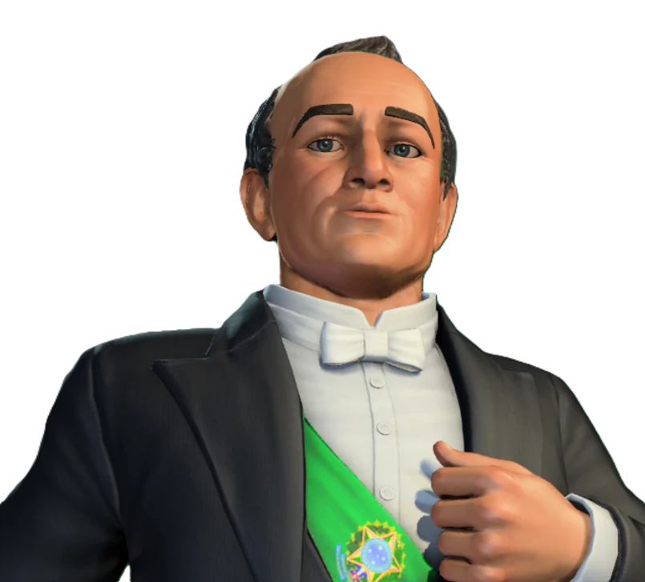

# Brazil — Getúlio Vargas 1.0

A new playable nation for ARA: History Untold 2.1.0.542: **Brazil** (`ntn_Brazil`), led by **Getúlio Vargas**. Part of **Project ARA: Reborn**; works on its own or together with the Soviet Union.

## Content
- **Leader feature — Estado Novo:** +50% build production towards Industry improvements and +5 to all citizen stats in all cities.
- **Unique unit — Pracinhas:** rifle-armed ranged infantry of the Brazilian Expeditionary Force.
- Own AI personality, improvements, recipes and technologies, and a fixed starting position.
- **3D leader model** in the leader screen: face, hair and suit with the presidential sash. Also portraits, emblems and a flag.
- **Custom introduction narration** in English and Brazilian Portuguese. It was generated with Coqui XTTS-v2 using a stock studio voice; no real person's voice was cloned.
- **Localization:** English and **Brazilian Portuguese (PT-BR)**, following the game language.

## Compatibility
- Works with every other Project ARA: Reborn mod, including the Soviet Union mod: both use the same leader base and ship the same starting positions file.
- **DLL:** the leader base replaces `bin\swscale-7.dll`. Another mod that replaces the same DLL can't be used at the same time.
- **Game data:** the mod replaces these game entries:
  - technologies `tch_Industrialization`, `tch_InterchangeableParts` and `tch_MassProducedTextiles`, which unlock the Pracinhas equipment recipe;
  - improvement `imp_Stable`, where the Pracinhas equipment is made;
  - the Earth map starting positions (`UniqueStartInfo`), which place Brazil in Rio de Janeiro.

  When another enabled mod replaces the same entries, the game uses only one version, and parts of the mod can stop working: for example the Pracinhas are never unlocked, or Brazil gets no fixed starting position.
- **Known conflict:** *Naxt's Grand ReFlavor Mod* (mod.io) replaces `tch_Industrialization`, `tch_MassProducedTextiles` and `imp_Stable`. Don't enable it together with this mod.

## Install
1. Close the game.
2. Run `INSTALL.bat`.
   - It installs the **leader base**, which patches the game's character packages from the original Steam files. Details are in `base\BASE_README.md`. About 4.5 GB of free space is needed during installation.
   - It copies `Mods\Brasil`.
3. Enable the **Brasil** mod when starting a **new game**.

To remove the mod, run `UNINSTALL.bat`. If the Soviet Union mod is still installed, the leader base stays. Otherwise the original game files are restored.
